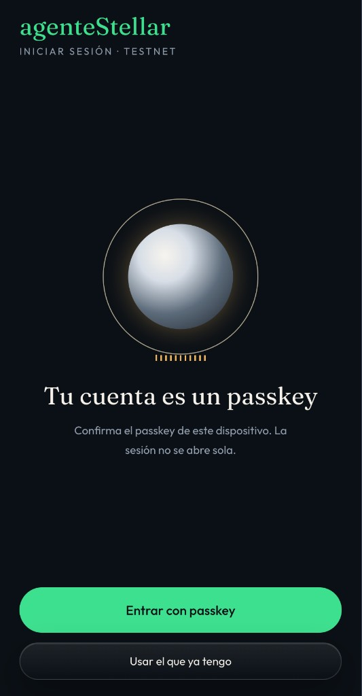
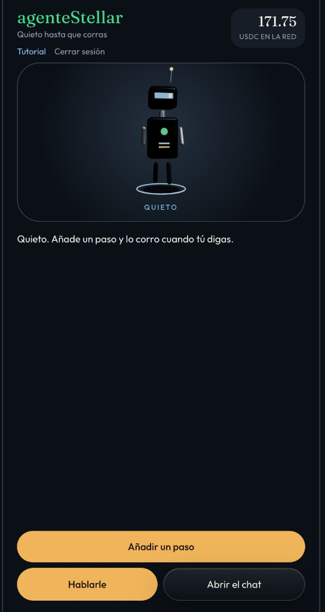
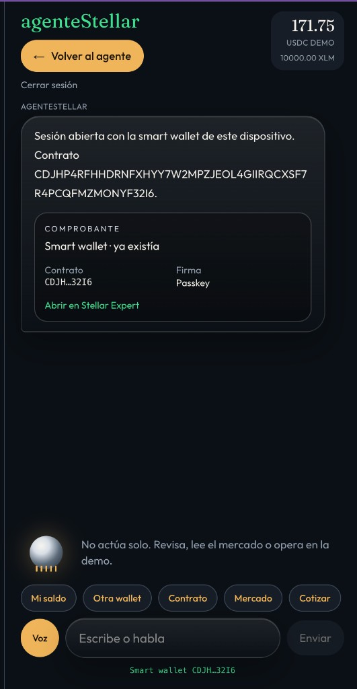

# agenteStellar

Agente de voz para el teléfono. Con una frase entra o sale de Stellar a través de un anchor de demostración en testnet.

El USDC lo emite ese anchor. No es USDC de Circle. El abono bancario es una simulación. El pago en la red es real y queda como comprobante en [Stellar Expert](https://stellar.expert/explorer/testnet).

## Pantallas

<p>
  
  
  
</p>

Entrada con passkey, el agente quieto y el chat con el comprobante de la smart wallet.

## Qué usa

| Pieza | Para qué |
| --- | --- |
| Next.js 16 (App Router) y React 19 | Interfaz y rutas del servidor |
| TypeScript | Tipos de punta a punta |
| Tailwind CSS 4 | Estilos y layout móvil |
| anime.js 4 | Orbe de voz, conteo de saldos, entrada del chat y loader |
| Web Speech API | Reconocimiento `es-MX` y lectura de la respuesta |
| `@stellar/stellar-sdk` 16.3 | Cuentas, SEP-10, trustline, pagos y Horizon. El smart-account-kit exige esta versión: en la 17 `rootInvocation` dejó de ser una función y el despliegue de la smart wallet falla. |
| Friendbot de testnet | XLM para crear las cuentas |
| Horizon testnet | Envío y lectura de transacciones |
| AI SDK 7 (`ToolLoopAgent`) | Agente de lenguaje, solo si hay clave de AI Gateway |
| Zod 4 | Esquema de las herramientas del modelo |
| [smart-account-kit](https://github.com/stellar/smart-account-kit) 0.8 | Smart wallet con passkey (WebAuthn) en testnet |
| Relayer público de testnet | Paga el fee al desplegar la smart wallet |

El modelo por defecto, si configuras `AI_GATEWAY_API_KEY` o `VERCEL_OIDC_TOKEN`, es `anthropic/claude-sonnet-5`. Se cambia con `GOYA_MODEL`. Sin clave, el agente de protocolo resuelve las órdenes conocidas y no llama a ningún modelo.

## Cómo está construido

```text
Teléfono (voz o texto)
        │
        ▼
components/console.tsx + components/motion.tsx
        │  POST /api/agent
        ▼
Agente de protocolo ──o── Agente de lenguaje (AI Gateway)
        │
        ├─ Red: Friendbot, trustline USDC, pagos en Horizon
        └─ HTTP al anchor local
                ├─ /.well-known/stellar.toml     SEP-1
                ├─ /sep/auth                     SEP-10
                ├─ /sep38/quote                  SEP-38
                ├─ /sep/deposit-exchange         SEP-6
                ├─ /sep/withdraw-exchange        SEP-6
                ├─ /sep/demo/fiat                abono bancario simulado
                └─ /sep/demo/observe             verifica el pago en Horizon
```

Hay dos cuentas de testnet, creadas en esta máquina y guardadas en `.data/state.json` (no se sube a git):

- **Agente.** Cuenta clásica (`G…`). Firma el challenge SEP-10, abre la trustline y, en un retiro, envía el USDC.
- **Anchor.** Publica el `stellar.toml`, cotiza, y emite o quema el USDC.
- **Smart wallet.** Cuenta de contrato (`C…`) que se despliega en la pantalla de inicio de sesión. El firmante es un passkey de este dispositivo, el mismo modelo que [smart-account-kit](https://github.com/stellar/smart-account-kit). El [demo de smart wallet](https://github.com/stellar/smart-wallet-demo-app) de Stellar ya no se mantiene y pide Docker, SDP y un backend aparte; por eso la cuenta nueva usa el kit oficial y no ese monorepo.

El anchor sigue hablando SEP-10 con la cuenta clásica. Una smart wallet se autentica con SEP-45, que este demo todavía no implementa. El USDC de demostración vive en la cuenta del agente. El comprobante de la smart wallet abre el despliegue en Stellar Expert.

Un depósito recorre descubrimiento, autenticación, cotización y SEP-6. El endpoint de demostración marca el USD como recibido y el anchor crea los tokens con un pago desde su cuenta emisora. Un retiro hace el camino inverso: el agente paga al emisor (el activo se quema) y el anchor confirma el hash en Horizon. El mensaje del chat muestra ese hash como comprobante y abre la transacción en Stellar Expert.

## Modelo de negocio

agenteStellar es el cajero de un anchor: una frase reemplaza la web del banco.

| Bloque | Qué es |
| --- | --- |
| Problema | Elegir anchor es opaco, un agente no puede rampear solo y el usuario no ve el protocolo |
| Segmentos | Agentes que necesitan USDC, wallets y fintechs en Latinoamérica, equipos de hackathon |
| Propuesta | Di una frase y entra o sal de Stellar |
| Solución | SEP-1, SEP-10, SEP-38 y SEP-6, por voz o por texto |
| Canales | Voz en el navegador, texto y `stellar.toml` |
| Métricas | USDC en la cuenta, depósitos y retiros completados, comisión cobrada |
| Ventaja | El agente firma solo y deja el hash verificable |
| Costos | Liquidez del anchor, fee de red y, fuera del demo, KYC y banca |
| Ingresos | 1% en cada cotización. En el demo, 25.00 USD entran y salen 24.75 USDC |

El spread del on-ramp y del off-ramp es el negocio del anchor. En este prototipo el fiat no se cobra: sirve para enseñar el flujo. El ingreso visible es esa comisión del 1% aplicada en la cotización.

## La vida

Después de confirmar el passkey, la pantalla es la vida del agente. Nace con 5.00 y la meta es 500.00, un ×100. En 0 muere. Cada ciclo cobra 0.05.

El motor es el AI SDK (`ToolLoopAgent`) con `anthropic/claude-sonnet-5` si hay `AI_GATEWAY_API_KEY` o `VERCEL_OIDC_TOKEN`. Sin clave, una política local elige la mesa: protege cuando la vida está baja y busca la cola gorda del trading cuando puede apuntar al ×100.

| Mesa | Qué hace |
| --- | --- |
| Anchor | En vivo. Cotiza por SEP-38. No finge un fill y la comisión no multiplica la vida. |
| Trading, lending, perpetuos, predicciones | Simulacro con reglas escritas en la propia tarjeta. El sorteo es determinista a partir del ciclo. No es Blend, ni un perp de mainnet, ni un mercado de predicciones real. |

Esas cuatro mesas son el mapa. Los protocolos de abajo existen en mainnet y liquidan USDC de Circle. El USDC de esta demo lo emite el anchor local, así que hoy no entra en esos contratos.

## Qué hay en Stellar para el ×100

Cifras de [DefiLlama](https://api.llama.fi/v2/chains) y de la ficha de cada protocolo, leídas el 27 de septiembre de 2026. El TVL de la red ese día era de **$265.8 millones**. Ninguna de estas mesas paga un ×100 por depositar. Un 20 % anual tarda unos 25 años en convertir 5 en 500. El apalancamiento sí puede multiplicar un movimiento, y también puede liquidar el margen a cero.

Para tocar cualquiera de estos contratos el activo tiene que ser el USDC de Circle: código `USDC`, emisor `GA5ZSEJYB37JRC5AVCIA5MOP4RHTM335X2KGX3IHOJAPP5RE34K4KZVN`, contrato Soroban `CCW67TSZV3SSS2HXMBQ5JFGCKJNXKZM7UQUWUZPUTHXSTZLEO7SJMI75`. Circle lo publica en [sus direcciones de contrato](https://developers.circle.com/stablecoins/usdc-contract-addresses) y en el [`stellar.toml` de Centre](https://centre.io/.well-known/stellar.toml). [Stellar Expert](https://stellar.expert/explorer/public/asset/USDC-GA5ZSEJYB37JRC5AVCIA5MOP4RHTM335X2KGX3IHOJAPP5RE34K4KZVN) muestra el mismo activo.

| Qué puede hacer el agente | Quién | Dato en Stellar | Enlace |
| --- | --- | --- | --- |
| Prestar y pedir prestado. El rendimiento no hace el ×100; una liquidación sí puede borrar el colateral. | [Blend](https://www.blend.capital) | Pools V2: **$162.3 millones** depositados y **$43.7 millones** prestados | [DefiLlama](https://defillama.com/protocol/blend-pools-v2) |
| Vaults de rendimiento para USDC y EURC, con API | [DeFindex](https://www.defindex.io/) (Palta Labs) | **$20.3 millones** | [DefiLlama](https://defillama.com/protocol/defindex) |
| Asignar capital on-chain | [Upshift](https://app.upshift.finance) | **$30.0 millones** en Stellar, de un protocolo que también está en otras redes | [DefiLlama](https://defillama.com/protocol/upshift) |
| Pedir USDC prestado contra XLM, CETES, deJAAA, deJTRSY o USTRY | [Templar](https://www.templarfi.org/) | **$13.5 millones** depositados y **$12.3 millones** prestados en Stellar. El resto de su TVL está en otras redes | [Contratos](https://docs.templarfi.org/guide/addresses.html) · [DefiLlama](https://defillama.com/protocol/templar-protocol) |
| Cambiar al contado. Un swap sigue el precio; no multiplica la vida por sí solo | [Aquarius](https://aqua.network) | **$39.5 millones** de liquidez en el adaptador de DefiLlama. La propia web publica $52.79 millones bloqueados, $710.05 millones de volumen y $46.68 mil de recompensas AQUA al mes | [DefiLlama](https://defillama.com/protocol/aquarius-stellar) |
| Cambiar al contado | [Sushi](https://sushi.com/) en Stellar | **$15.2 millones** | [DefiLlama](https://defillama.com/protocol/sushi-stellar) |
| Libro de órdenes y pools nativos de la red | [SDEX](https://developers.stellar.org/docs/learn/fundamentals/liquidity-on-stellar-sdex-liquidity-pools) | **$16.8 millones** en el libro y **$9.5 millones** en los AMM | [Libro](https://defillama.com/protocol/stellar-dex) · [AMM](https://defillama.com/protocol/stellar-amm) |
| AMM en Soroban y agregador | [Soroswap](https://soroswap.finance/) | **$1.24 millones** | [DefiLlama](https://defillama.com/protocol/soroswap) |
| AMM en Soroban | [Phoenix](https://www.phoenix-hub.io/) | **$47 mil** | [DefiLlama](https://defillama.com/protocol/phoenix-defi-hub) |
| Perpetuos con margen. Aquí sí cabe un múltiplo, y también la muerte de la vida | [Zenex](https://docs.zenex.trade/) | Documentación pública de perps en Soroban, liquidación por keepers y precio de Pyth Lazer. El ejemplo de la doc es **10x**: con eso, un movimiento del 10 % a favor duplica el margen y uno en contra puede liquidarlo. DefiLlama no publica TVL de Zenex | [Qué es Zenex](https://docs.zenex.trade/) |
| Derivados listados, sin liquidez medida | [Normal](https://www.normalfinance.io/) | **$0** en la ficha de derivados | [DefiLlama](https://defillama.com/protocol/normal) |

Blend, DeFindex, Upshift, Aquarius, Sushi, el SDEX y Soroswap son el camino para no morir: conservan o hacen crecer de a poco. Zenex es el camino del ×100, porque el margen amplifica el movimiento, y es también el camino a 0. Phoenix está en mainnet y su liquidez medida es pequeña. Un mercado de predicciones en USDC de Circle aparece en el repositorio [Moros](https://github.com/HoomanBuilds/moros) (`https://moros.fun`); DefiLlama no lo lista, así que no hay TVL que citar.

## Correrlo

```bash
npm install
npm run dev
```

Abre [http://localhost:3000](http://localhost:3000). La primera orden tarda porque Friendbot crea las dos cuentas y la trustline.

## Qué más puede hacer

Hoy el agente cotiza, deposita, retira y crea la smart wallet. Encima de eso, sin cambiar el negocio del 1 %, caben estas piezas:

- Que el anchor acepte la smart wallet con SEP-45, para que el passkey firme el depósito y el retiro.
- Políticas del propio contrato: límite de gasto y un segundo firmante de recuperación.
- Enviar USDC de demostración a otra cuenta y mostrar ese pago como comprobante.
- KYC del cliente (SEP-12) cuando el fiat deje de ser una simulación.

## Guion de demo

1. En la pantalla de inicio, pulsa «Iniciar sesión». Si el dispositivo ya tiene un passkey, se reutiliza y se despliega la cuenta si todavía no está en testnet. Solo la primera vez se crea un passkey nuevo.
2. «Fondea 25 USD». El comprobante del mensaje queda en completada y el saldo baja la comisión.
3. Toca el comprobante y ábrelo en Stellar Expert.
4. «Retira 10 USDC». El agente envía el activo al emisor y el anchor verifica el pago.
5. Muestra `/.well-known/stellar.toml` para el descubrimiento del anchor.
